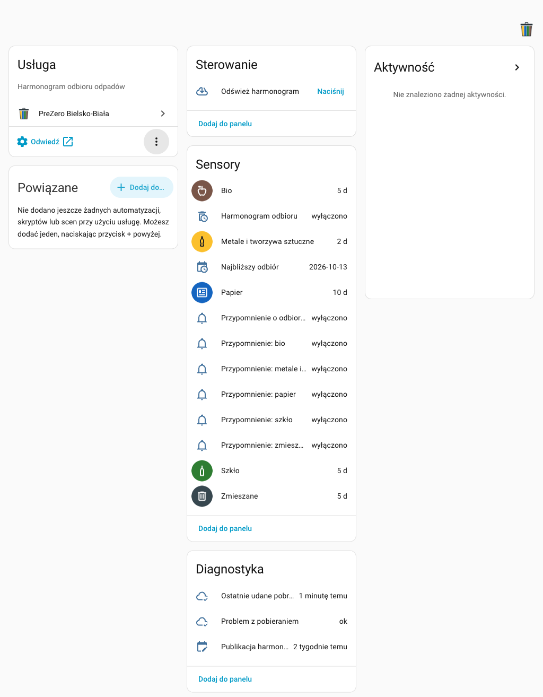
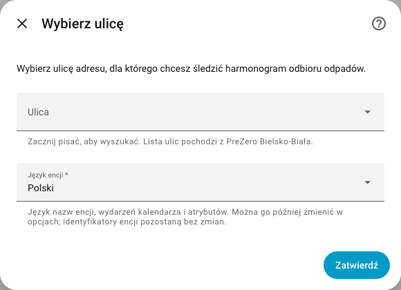
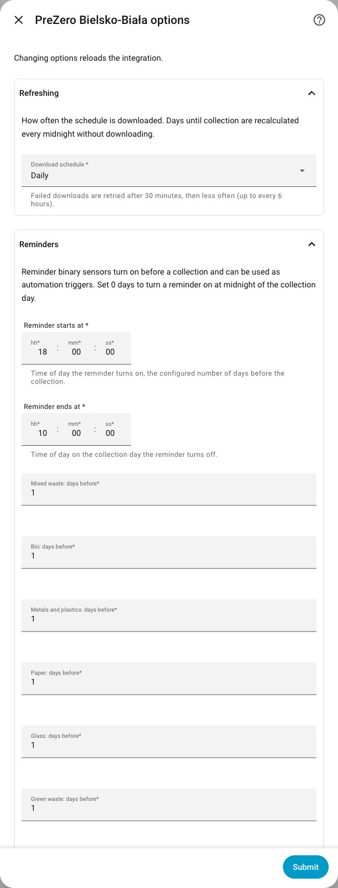

# PreZero Bielsko-Biała for Home Assistant

[](https://github.com/igor-zukowski/ha-prezero-bielsko/stargazers)
[](https://github.com/igor-zukowski/ha-prezero-bielsko/releases)
[](https://github.com/igor-zukowski/ha-prezero-bielsko/actions/workflows/validate.yml)
[](https://github.com/igor-zukowski/ha-prezero-bielsko/actions/workflows/hassfest.yml)
[](https://github.com/igor-zukowski/ha-prezero-bielsko/actions/workflows/tests.yml)

Home Assistant custom integration for the
[PreZero Bielsko-Biała waste collection schedule](https://prezero-bielsko.pl/harmonogram-odbioru-odpadow/).
It shows which waste is collected in how many days, provides reminder entities to trigger
automations before a collection and tells you when the schedule cannot be downloaded.

Created and maintained by [Igor Zukowski](https://github.com/igor-zukowski).

If this integration is useful for your Home Assistant setup, please consider
[starring the repository](https://github.com/igor-zukowski/ha-prezero-bielsko) or supporting ongoing development.

<a href="https://buymeacoffee.com/igorzukowski" target="_blank">
  
</a>

> This project is not affiliated with or endorsed by PreZero. It reads the public schedule
> published on the PreZero Bielsko-Biała website.



## Features

- UI setup: search your street, pick the house number, done. Addresses with multiple schedules ask which one to use.
- Sensor per waste fraction with the **number of days until the next collection**.
- **Next collection** sensor with the date and all fractions collected that day.
- **Reminder binary sensors** per fraction, turning on a configurable number of days before the collection, for example the evening before. Each fraction can have its own number of days.
- Combined **collection reminder** sensor: one automation for all fractions.
- **Calendar** with all collections, usable in the calendar dashboard and in calendar triggers.
- **Refresh schedule** button to download the latest schedule on demand.
- Configurable download interval: daily, weekly or monthly.
- **Colored pictures** for every fraction with configurable colors (paper blue, glass green, metals and plastics yellow…).
- **Download problem** sensor and Home Assistant repair issues when the schedule cannot be downloaded.
- Works offline: the last downloaded schedule is cached and used after restarts and outages.
- Handles the new year automatically, including the next year's schedule downloaded in December.
- `prezero_bielsko.get_schedule` action returning upcoming collections for scripts and notifications.
- `prezero_bielsko_schedule_updated` event when PreZero publishes changes.
- Multiple addresses supported, each as a separate service device.
- Entity names in **Polish** (default) or English, chosen per address independently of the Home Assistant language.
- Polish and English UI translations. No additional Python dependencies.

## Requirements

- Home Assistant 2025.8.0 or newer.
- HACS, or manual access to the Home Assistant `custom_components` directory.
- An address in Bielsko-Biała listed on the [PreZero Bielsko-Biała schedule page](https://prezero-bielsko.pl/harmonogram-odbioru-odpadow/).

## Installation

### HACS

[](https://my.home-assistant.io/redirect/hacs_repository/?owner=igor-zukowski&repository=ha-prezero-bielsko&category=integration)

1. Open HACS in Home Assistant.
2. Add this repository as a custom integration repository if it is not yet available in the default HACS store.
3. Install **PreZero Bielsko-Biała**.
4. Restart Home Assistant.
5. Go to **Settings > Devices & services > Add integration** and search for **PreZero Bielsko-Biała**.

### Manual

1. Copy `custom_components/prezero_bielsko` into your Home Assistant `custom_components` directory.
2. Restart Home Assistant.
3. Go to **Settings > Devices & services > Add integration** and search for **PreZero Bielsko-Biała**.

## Setup



| Step | Description |
| --- | --- |
| Street | Start typing to search the list of streets published by PreZero. Typing is case insensitive. |
| Entity language | Language of entity names, calendar events and attributes: **Polski** (default), English or the Home Assistant language. Entity IDs are created in this language. |
| House number | Numbers published for the selected street, for example `6A`, `27/1,3,5` or `b/n`. |
| Schedule | Shown only when PreZero publishes more than one schedule for the address, for example for separate buildings or businesses. Choose the symbol printed on your schedule. |

The setup checks that a schedule exists for the current year. Every address creates one config entry and
one service device named after the address, for example **3 Maja 1**.

To change the address later without losing entities and history, use
**Settings > Devices & services > PreZero Bielsko-Biała > ⋮ > Reconfigure**.

## Options

Open the options from **Settings > Devices & services > PreZero Bielsko-Biała > Configure**.



| Option | Default | Description |
| --- | --- | --- |
| Entity language | Polski | Language of entity names, calendar events and attributes: Polski, English or the Home Assistant language. Changing it renames entities, their IDs stay the same. |
| Download schedule | Daily | How often the schedule is downloaded: daily, weekly or monthly. Days until collection are recalculated at midnight without downloading. |
| Reminder starts at | 18:00 | Time the reminders turn on, the configured number of days before the collection. |
| Reminder ends at | 10:00 | Time the reminders turn off on the collection day. |
| *Fraction*: days before | 1 | Number of days before the collection the reminder of this fraction turns on, 0–14. With 0 the reminder turns on at midnight of the collection day. |
| Use colored pictures | On | Show colored fraction pictures instead of icons. |
| *Fraction*: color | see below | Color of the fraction picture and of the `color` attribute. |

Only fractions collected at your address are listed. Changing options reloads the integration.

## Entities

Entity IDs below use an address named **3 Maja 1** with the default Polish entity language.
With English they are named in English, for example `sensor.3_maja_1_paper` instead of `sensor.3_maja_1_papier`.

### Days until collection

`sensor.3_maja_1_papier`, `sensor.3_maja_1_szklo`, … one sensor per fraction collected at the address.

| Polish name (entity ID) | English name | Default color |
| --- | --- | --- |
| Zmieszane (`zmieszane`) | Mixed waste | `#37474F` |
| Bio (`bio`) | Bio | `#795548` |
| Metale i tworzywa sztuczne (`metale_i_tworzywa_sztuczne`) | Metals and plastics | `#FBC02D` |
| Papier (`papier`) | Paper | `#1565C0` |
| Szkło (`szklo`) | Glass | `#2E7D32` |
| Zielone (`zielone`) | Green waste | `#7CB342` |
| Popiół (`popiol`) | Ash | `#9E9E9E` |
| Gabaryty (`gabaryty`) | Bulky waste | `#8E24AA` |

State: number of days until the next collection (`0` means today). `unknown` when no further collection is published.

| Attribute | Description |
| --- | --- |
| `next_date` | Date of the next collection. |
| `upcoming` | The next three collection dates. |
| `fraction` | Localized fraction name. |
| `color` | Configured fraction color, for example for card-mod or Mushroom cards. |

A fraction that PreZero adds later gets its sensor automatically.

### Next collection

`sensor.3_maja_1_najblizszy_odbior` with the date of the nearest collection.

| Attribute | Description |
| --- | --- |
| `fractions` | Localized names of all fractions collected that day. |
| `fraction_keys` | PreZero keys of these fractions, for example `makulatura`, `szklo`. |
| `days` | Days until that collection. |
| `pdf_url` | Link to the printable PDF schedule of the current year. |

### Reminders

`binary_sensor.3_maja_1_przypomnienie_papier`, … one per fraction, plus
`binary_sensor.3_maja_1_przypomnienie_o_odbiorze` combining all fractions.

A reminder is **on** from *days before* at *reminder starts at* until *reminder ends at* on the collection day.
With the defaults the reminder **Przypomnienie: papier** for a Thursday collection is on from Wednesday 18:00 to Thursday 10:00.
The state changes exactly at these times and is restored correctly after a restart. An active reminder
shows the colored fraction picture, an inactive one a bell icon.

| Attribute | Description |
| --- | --- |
| `collection_date` | Collection the reminder refers to (active or next). |
| `days_before` | Configured number of days. |
| `fractions`, `fraction_keys` | Combined sensor only: fractions with an active reminder. |

### Calendar

`calendar.3_maja_1_harmonogram_odbioru` contains an all day event per fraction and collection day.

### Refresh schedule

`button.3_maja_1_odswiez_harmonogram` downloads the latest schedule right away. If the download
fails, the error is shown in the UI.

### Diagnostics

| Entity | Description |
| --- | --- |
| `binary_sensor.3_maja_1_problem_z_pobieraniem` | **On when the last download failed.** Attributes `error` and `failures`. Other entities keep working with the last downloaded schedule. |
| `sensor.3_maja_1_ostatnie_udane_pobranie` | Time of the last successful download. |
| `sensor.3_maja_1_publikacja_harmonogramu` | Time PreZero last published changes of the schedule. |

## Download problems

The integration is designed to keep working when the PreZero website is unavailable:

- The last downloaded schedule is stored and used after a restart, also without internet access.
- A failed download is retried after 30 minutes, 1, 2 and 4 hours, then every 6 hours (never later than the configured interval). After a success the configured interval is used again.
- `binary_sensor.…_download_problem` turns on immediately, so you can be notified by an automation.
- Home Assistant **repair issues** (Settings > System > Repairs) are raised for:
  - downloads failing for more than a day,
  - no schedule published for the current year yet, usually at the start of a year,
  - the address no longer found on the PreZero website, for example after a street rename.

  Issues disappear automatically when the problem is resolved.

## Actions

### `prezero_bielsko.get_schedule`

Returns upcoming collections of a configured address. This action returns response data.

| Field | Required | Description |
| --- | --- | --- |
| `config_entry_id` | Yes | The configured address. |
| `days` | No | Number of days ahead, 1–400. Default: `30`. |

Response:

```yaml
address: 3 Maja 1
collections:
  - date: "2026-10-15"
    days: 4
    fraction: makulatura
    name: Papier
  - date: "2026-10-15"
    days: 4
    fraction: szklo
    name: Szkło
```

## Events

### `prezero_bielsko_schedule_updated`

Fired when PreZero publishes a changed schedule for the current year.

| Field | Description |
| --- | --- |
| `config_entry_id` | Config entry of the address. |
| `address` | Address name. |
| `year` | Year of the schedule. |
| `published`, `previous_published` | New and previous publication time. |
| `added`, `removed` | Collections added and removed, each with `date` and `fraction`. |

## Examples

### Evening reminder notification

```yaml
alias: Waste collection reminder
triggers:
  - trigger: state
    entity_id: binary_sensor.3_maja_1_przypomnienie_o_odbiorze
    to: "on"
actions:
  - action: notify.mobile_app_phone
    data:
      title: Take out the bins
      message: >-
        {{ state_attr('binary_sensor.3_maja_1_przypomnienie_o_odbiorze', 'fractions') | join(', ') }}
        will be collected on
        {{ state_attr('binary_sensor.3_maja_1_przypomnienie_o_odbiorze', 'collection_date') }}.
```

### Notify about download problems

```yaml
alias: Waste schedule download problem
triggers:
  - trigger: state
    entity_id: binary_sensor.3_maja_1_problem_z_pobieraniem
    to: "on"
    for: "06:00:00"
actions:
  - action: notify.mobile_app_phone
    data:
      title: Waste schedule
      message: >-
        The PreZero schedule cannot be downloaded:
        {{ state_attr('binary_sensor.3_maja_1_problem_z_pobieraniem', 'error') }}
```

### Calendar trigger

```yaml
triggers:
  - trigger: calendar
    event: start
    entity_id: calendar.3_maja_1_harmonogram_odbioru
    offset: "-6:00:00"
actions:
  - action: notify.mobile_app_phone
    data:
      message: "Tomorrow: {{ trigger.calendar_event.summary }}"
```

### Schedule changed

```yaml
triggers:
  - trigger: event
    event_type: prezero_bielsko_schedule_updated
actions:
  - action: persistent_notification.create
    data:
      title: Waste schedule changed
      message: >-
        Added: {{ trigger.event.data.added | map(attribute='date') | join(', ') }}.
        Removed: {{ trigger.event.data.removed | map(attribute='date') | join(', ') }}.
```

### Dashboard card

```yaml
type: entities
title: Waste collection
entities:
  - entity: sensor.3_maja_1_najblizszy_odbior
  - entity: sensor.3_maja_1_zmieszane
  - entity: sensor.3_maja_1_bio
  - entity: sensor.3_maja_1_metale_i_tworzywa_sztuczne
  - entity: sensor.3_maja_1_papier
  - entity: sensor.3_maja_1_szklo
  - entity: button.3_maja_1_odswiez_harmonogram
```

## How it works

- Data comes from the same endpoint as the schedule page on the PreZero website. No account or API key is needed.
- A regular download is a single small request. The schedule symbol of the address is looked up again only when a new year starts or the schedule is empty.
- Days until collection and reminders are calculated locally; reminders use exact timers, not polling.
- The colored pictures are small SVG images generated by the integration at `/api/prezero_bielsko/icon/<fraction>.svg`.
- Diagnostics (**⋮ > Download diagnostics**) do not contain your address.

## Troubleshooting

- **The street or number is missing:** the lists come from PreZero. Check the address on the [schedule page](https://prezero-bielsko.pl/harmonogram-odbioru-odpadow/).
- **"There is no schedule for this address in the current year yet":** PreZero has not published it; try again later.
- **Download problem is on:** check the internet connection of Home Assistant and whether the PreZero website works, then press **Refresh schedule**. Enable debug logging from the integration page for details.
- **Address not found repair issue:** reconfigure the entry and select the address again.
- **Wrong reminder time:** reminders use the Home Assistant time zone; check **Settings > System > General**.

## Development

Local checks:

```bash
python -m pip install -r requirements_test.txt
pytest --cov
ruff check .
ruff format --check .
mypy custom_components/prezero_bielsko
```

Tests for the minimum supported Home Assistant version use `requirements_test_min.txt` with Python 3.13.
Contract tests against the real website: `pytest tests_live -p no:homeassistant`.

The repository includes GitHub workflows for HACS validation, Hassfest validation, linting, tests on the
minimum and latest Home Assistant versions and a weekly check of the PreZero website. A new GitHub release
should be created after these workflows pass, with the tag matching `version` in `manifest.json`.

Fraction pictures use glyphs from [Material Design Icons](https://pictogrammers.com/library/mdi/) (Apache License 2.0).

## License

[MIT](LICENSE)
